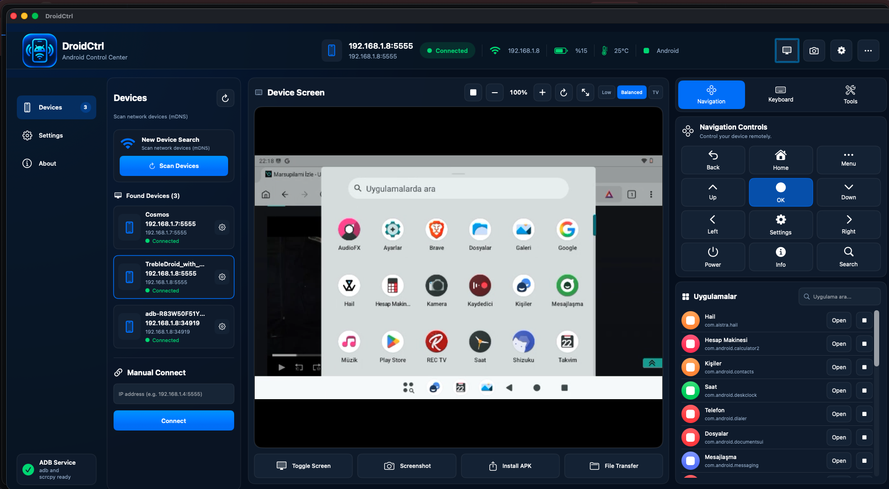
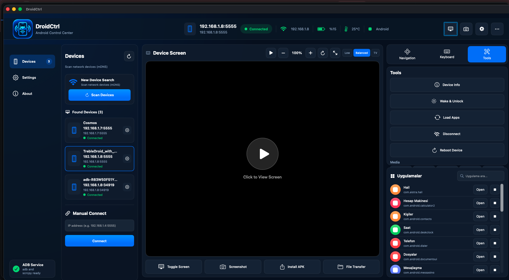
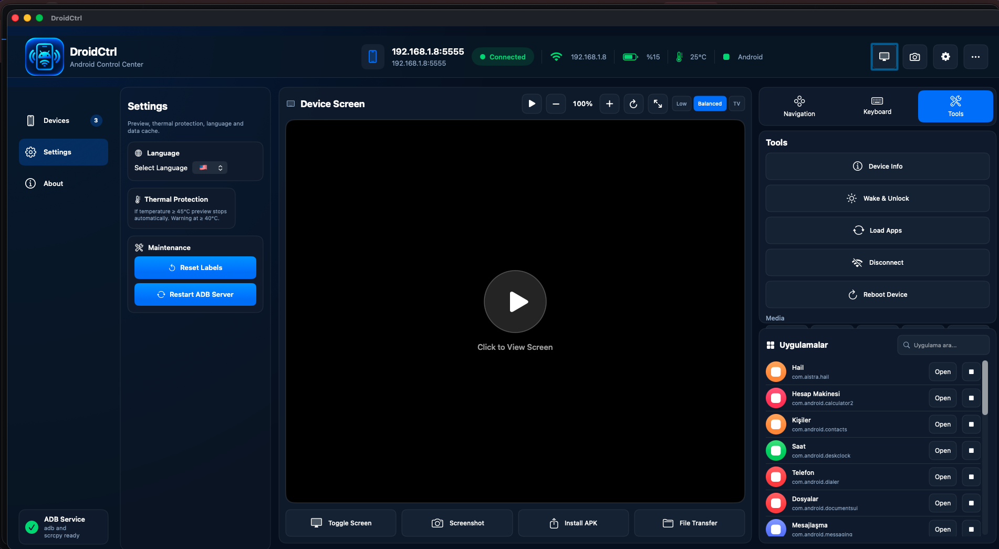

# DroidCtrl

> **Professional Android Device Control Center for macOS**

Control Android devices (phones, tablets, TVs) from your Mac over ADB with embedded scrcpy — device selection, app launching, keyboard/mouse/media control, live preview, and more.


---

## 🚀 Quick Install (Easiest)

### **Download the DMG Installer** ⭐ **Recommended**
1. Download **[DroidCtrl.dmg](dist/DroidCtrl.dmg)** (4.7 MB)
2. Double-click the DMG to open it
3. Drag `DroidCtrl.app` to the `Applications` folder shortcut
4. Launch from **Launchpad**, **Applications folder**, or **Spotlight**

> The DMG includes the complete app with all icons, 6 languages, and embedded scrcpy — no additional downloads needed.

---

## 📱 Features

### 🎮 Device Control
- **Multi-device support** — Connect multiple Android devices via USB, WiFi (TCP/IP), or wireless debugging
- **Auto-discovery** — mDNS/Bonjour scanning for devices on local network
- **Wireless pairing** — Android 11+ wireless debugging pairing wizard
- **Persistent connections** — Auto-reconnect with exponential backoff

### 🖥️ Live Preview (scrcpy)
- **Real-time screen mirroring** — Embedded scrcpy client, no separate install needed
- **Quality presets** — Low (160p), Balanced (720p), High (1080p/4K native)
- **Thermal protection** — Auto-stops at 45°C, warns at 40°C
- **Battery efficient** — Preview only runs when you open it, not continuously

### ⌨️ Input Control
- **Navigation grid** — Back, Home, Recents, D-pad, OK, Power, Settings, Search
- **Text input** — Type on Mac, sends to Android focused field
- **Keyboard shortcuts** — Enter, Delete, custom keycodes
- **Media controls** — Play/pause, next/prev, rewind/fast-forward, volume

### 📦 App Management
- **App launcher** — Visual grid with icons, labels, package names
- **App search** — Filter by name or package
- **Force stop** — Kill background apps
- **APK install** — Drag & drop .apk files to install
- **File transfer** — Push files to device storage

### 🛠️ Advanced Tools
- **Device info** — Model, Android version, battery, temperature, screen resolution
- **Wake & unlock** — Turn on screen and dismiss keyguard
- **Reboot** — Normal, recovery, bootloader
- **Screenshot** — Capture device screen to Mac
- **URL/Intent sending** — Open links directly on device
- **Label cache reset** — Refresh app labels after updates

### 🌍 Internationalization
**6 Languages** — English, Turkish, Spanish, Chinese (Simplified), German, Italian
- Runtime language switching
- Persistent preference (survives restart)
- Restart button for immediate UI refresh

### 🔒 Security & Privacy
- **Local network only** — No internet access, no telemetry
- **Ad-hoc signed** — Runs on your Mac without Apple Developer Program
- **No data collection** — Zero analytics, zero tracking
- **Device-side encryption** — scrcpy-server uses AES if configured

---

## 📸 Screenshots

### Main Dashboard

*Device list, live preview, navigation controls, and app management in one window*

### Settings Panel

*Language selector (6 languages), thermal protection status, maintenance tools*

### App Management

*Visual app grid with search, launch, force-stop, and install APK*

### Device Connection & Pairing

*mDNS discovery, manual IP entry, and wireless pairing wizard (shown in main dashboard)*

### Live Preview

*Real-time scrcpy stream with quality selector and fullscreen mode (shown in main dashboard)*

---

## 💾 Alternative: Build from Source

If you prefer to build yourself:

```bash
# Requirements: macOS 14+, Xcode 15+, Swift 5.9+
git clone https://github.com/caxlar/DroidCtrl.git
cd DroidCtrl
./make-app.sh

# App installs to /Applications/DroidCtrl.app
```

**Requirements:**
- macOS 14.0 (Sonoma) or later
- Xcode Command Line Tools (`xcode-select --install`)
- Android device with USB debugging OR wireless debugging (Android 11+) OR TCP/IP ADB

---

## 📖 Usage Guide

### First Connection
1. **Enable USB debugging** on Android: Settings → Developer options → USB debugging
2. **Connect via USB** — Device appears automatically in DroidCtrl
3. **Or connect wirelessly**:
   - Android 11+: Settings → Developer options → Wireless debugging → Pair with pairing code
   - Older: `adb tcpip 5555` then enter `IP:5555` in DroidCtrl

### Device Selection
- Click a device in the left sidebar to select it
- Selected device shows in header with battery, temperature, Android version
- Apps auto-load when device selected

### Live Preview
- Click **▶ Play** button in preview area to start streaming
- Click **■ Stop** to stop (saves battery/heat on device)
- Quality selector: **Low / Balanced / High** (top-right of preview)
- **Fullscreen** button opens dedicated window

### Navigation & Input
- Use navigation grid for system controls
- Type in text field → **Send** to input on device
- Media controls work with active media session

### App Management
- Search apps by name/package
- Click **Open** to launch
- Click **Stop** (⏹) to force-stop
- **Install APK** button → select .apk file
- **File Transfer** button → select files to push

### Settings
- **Language**: Select from 6 languages → click "Restart Now"
- **Thermal**: Shows current protection thresholds
- **Maintenance**: Reset labels, restart ADB server

---

## 🔧 Build & Development

### Build Commands
```bash
# Debug build
swift build

# Release build
swift build -c release

# Create .app bundle
./make-app.sh

# Create DMG installer
./make-app.sh && create-dmg --volname "DroidCtrl Installer" dist/DroidCtrl.dmg "/Applications/DroidCtrl.app"
```

### Project Structure
```
DroidCtrl/
├── Sources/DroidDeck/
│   ├── TrebleDroidDashboard.swift   # Main UI (SwiftUI)
│   ├── DashboardBridge.swift        # UI ↔ Business logic bridge
│   ├── DashboardHost.swift          # SwiftUI host with DeviceStore
│   ├── DeviceStore.swift            # ADB/scrcpy management
│   ├── ADB.swift                    # ADB protocol implementation
│   ├── LocalizationManager.swift    # i18n runtime switching
│   └── ...                          # Other components
├── Resources/
│   ├── Localizable.xcstrings        # String catalog (source of truth)
│   ├── *.lproj/Localizable.strings  # Compiled strings per language
│   ├── AppIcon.icns                 # Dock/Finder/Launchpad icon
│   ├── icon_80pt@1x.png             # Header icon (non-Retina)
│   ├── icon_80pt@2x.png             # Header icon (Retina)
│   └── Info.plist
├── make-app.sh                      # Build & package script
├── Package.swift                    # Swift Package manifest
└── dist/                            # Distribution artifacts (DMG here)
```

### Adding a New Language
1. Add language to `LocalizationManager.supportedLanguages`
2. Run `xcodebuild -exportLocalizations` or edit `Localizable.xcstrings` in Xcode
3. Add `.lproj/Localizable.strings` for the new locale
4. Update `Info.plist` `CFBundleLocalizations`
5. Add flag emoji in `LocalizationManager`

---

## 🌐 Localization Status

| Language | Code | Status | Native Name |
|---|---|---|---|
| English | `en` | ✅ Complete | English |
| Turkish | `tr` | ✅ Complete | Türkçe |
| Spanish | `es` | ✅ Complete | Español |
| Chinese (Simplified) | `zh-Hans` | ✅ Complete | 简体中文 |
| German | `de` | ✅ Complete | Deutsch |
| Italian | `it` | ✅ Complete | Italiano |

**169 localization keys** covering all UI text, buttons, tooltips, and messages.

---

## 🐛 Troubleshooting

| Issue | Solution |
|---|---|
| Device not found | Ensure USB debugging ON, same network, try "Scan" button |
| "Unidentified developer" | Right-click app → Open → Open, or `xattr -cr /Applications/DroidCtrl.app` |
| Preview not starting | Check device temperature < 45°C, try "Restart Preview" |
| Wireless debugging not working | Use pairing wizard, ensure correct port (not 5555) |
| App labels not updating | Settings → "Reset Labels" |
| ADB connection issues | Settings → "Restart ADB Server" |

---

## 📄 License

MIT License — See [LICENSE](LICENSE) for details.

---

## 🙏 Acknowledgments

- **[scrcpy](https://github.com/Genymobile/scrcpy)** — Amazing screen mirroring technology
- **[Genymobile](https://genymobile.com/)** — For scrcpy and ADB protocol work
- **SwiftUI & Swift Package Manager** — Modern macOS development

---

## 📞 Support

- **Issues**: [GitHub Issues](https://github.com/caxlar/DroidCtrl/issues)
- **Discussions**: [GitHub Discussions](https://github.com/caxlar/DroidCtrl/discussions)

---

*Made with ❤️ for Android developers and power users*
